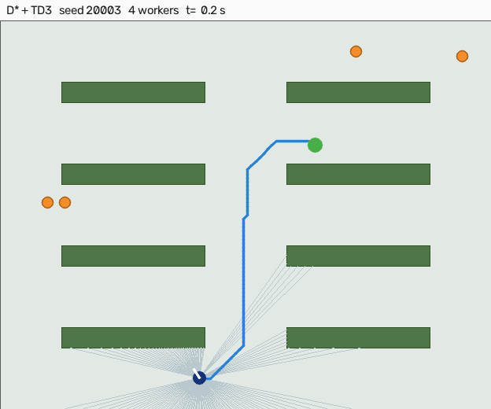

# Greenhouse Navigation: D* Lite with MPC and TD3 Local Control

Global replanning and local control for a mobile robot in a greenhouse with
walking workers. D* Lite plans on an inflated occupancy grid and repairs the
plan incrementally when the LiDAR sees a worker step into the aisle. Four
methods are compared on identical seeds: Regulated Pure Pursuit (the ROS 2 Nav2
default path follower), a nonlinear MPC, a TD3 policy used as the local
controller under the same global plan, and a TD3 policy run end to end with no
global plan at all.

> **About this repository.** This is a re-implementation, written in 2026, of the
> greenhouse navigation part of my 2024-25 undergraduate project (National Natural
> Science Foundation of China). The original ran TD3 in Gazebo on a ROS 1 stack;
> that code is not included here. This version rebuilds the same greenhouse layout
> in a lightweight 2D simulator, adds the classical D* Lite + MPC pipeline and
> dynamic obstacles, and every number below is produced by the code in this
> repository.

## Demo

The same episode under three methods, seed 20003 with 4 workers. The seed was
chosen by `scripts/make_demo.py --pick median`, which takes the seed whose mean
completion time over the three methods is closest to the median of a candidate
block, so this is a representative run and not the best one. Blue is the D* Lite
path, magenta is the MPC horizon, orange discs are workers, the pale cells are
the worker layer the planner currently has blocked.

| D* + RPP, 31.8 s | D* + MPC, 24.8 s | D* + TD3, 20.9 s |
|---|---|---|
|  |  |  |

## Headline result

The classical modular pipeline is the reliable one and the learned policies are
the fast one, and that trade does not reverse anywhere in the sweep.

- **D* + MPC never failed**: 400 of 400 episodes across every worker count and
  every aisle width.
- **D* + RPP lost three episodes of 400**, all timeouts, all in the density sweep.
- **TD3 finishes 15 to 25% faster when it succeeds** but is less reliable in every
  single cell of both tables.
- **The global plan is what carries the learned controller.** D* + TD3 beats
  end-to-end TD3 in all eight conditions.
- **TD3's failure mode changes with density.** At the original layout it times out
  or walks into a worker. As the aisles narrow it starts hitting racks: 8 rack
  collisions in 50 episodes at a 1.6 m aisle, against 0 at 3.0 m. It stops
  respecting static structure once the geometry leaves its training distribution.

## The greenhouse

The default layout reproduces the original Gazebo world `melon.world`: a 24 m x
19 m house with four rows of 7 m x 1 m planting racks, a 4 m central aisle and
3 m aisles between rows. Rack occupancy is 12.3% of the floor. Coordinates were
read from the original world file.

**On making it denser.** Narrowing `row_aisle` on its own does not make the house
harder. The racks keep their size, so the block of rows just packs tighter and
leaves more open floor above and below, which the planner routes around.
Measured: occupancy stays at 12.3% from a 3.0 m aisle down to a 1.3 m one while
the free margin above and below grows from 6.0 m to 11.1 m, and both classical
controllers stayed at 50/50 across that whole range. `rows_to_fill` therefore
sets the row count so the block keeps spanning the original extent, and a
narrower aisle adds rows instead of opening a bypass. That raises occupancy from
12.3% to 18.4% and drops free navigable cells from 68% to 52%, and it is what
the density table below uses.

## Methods

| | Global | Local |
|---|---|---|
| D* + RPP | D* Lite | Regulated Pure Pursuit, Macenski et al. 2023 (baseline) |
| D* + MPC | D* Lite | nonlinear MPC, CasADi / IPOPT, workers predicted at constant velocity |
| D* + TD3 | D* Lite | TD3 policy, LiDAR + the same lookahead point the others chase |
| TD3 end-to-end | none | TD3 policy, LiDAR + final goal |

## Results

<!-- the three tables per section are generated by scripts/make_tables.py -->

### Workers, at the original 3.0 m aisle

Success as n/50 with a Wilson 95% interval for a single policy, or as the mean
over three training seeds with the range in brackets.

| workers | D* + RPP | D* + MPC | D* + TD3 | TD3 end-to-end |
|---|---|---|---|---|
| 0 | 50/50 [93, 100] | 50/50 [93, 100] | 47.7/50 (47-49) | 44.7/50 (43-47) |
| 4 | 50/50 [93, 100] | 50/50 [93, 100] | 48.0/50 (47-49) | 43.3/50 (42-45) |
| 8 | 50/50 [93, 100] | 50/50 [93, 100] | 46.3/50 (45-48) | 45.3/50 (44-46) |

Median time to the goal over successful episodes, in seconds:

| workers | D* + RPP | D* + MPC | D* + TD3 | TD3 end-to-end |
|---|---|---|---|---|
| 0 | 22.9 | 23.5 | 19.1 | 18.9 |
| 4 | 25.5 | 24.2 | 19.9 | 19.8 |
| 8 | 28.4 | 24.6 | 20.1 | 20.8 |

Failures by cause, pooled over the three seeds:

| workers | D* + RPP | D* + MPC | D* + TD3 | TD3 end-to-end |
|---|---|---|---|---|
| 0 | none | none | 7 timeout | 16 timeout |
| 4 | none | none | 4 worker, 2 timeout | 1 rack, 9 worker, 10 timeout |
| 8 | none | none | 11 worker | 10 worker, 4 timeout |

RPP slows down as workers are added, 22.9 s to 28.4 s, because its proximity
regulation cuts speed near anything the LiDAR sees. MPC holds 23.5 s to 24.6 s,
which is what the constant-velocity worker prediction buys.

### Density, at 4 workers

One policy per method here. **The TD3 policies were trained only at the 3.0 m,
four-row layout, so every narrower row is out of distribution for them and in
distribution for the two classical controllers.**

| aisle | D* + RPP | D* + MPC | D* + TD3 | TD3 end-to-end |
|---|---|---|---|---|
| 3.0 m, 4 rows | 50/50 [93, 100] | 50/50 [93, 100] | 48.0/50 (47-49) | 43.3/50 (42-45) |
| 2.4 m, 5 rows | 49/50 [90, 100] | 50/50 [93, 100] | 47/50 [84, 98] | 41/50 [69, 90] |
| 2.0 m, 5 rows | 49/50 [90, 100] | 50/50 [93, 100] | 43/50 [74, 93] | 39/50 [65, 87] |
| 1.6 m, 6 rows | 49/50 [90, 100] | 50/50 [93, 100] | 34/50 [54, 79] | 22/50 [31, 58] |
| 1.3 m, 6 rows | 50/50 [93, 100] | 50/50 [93, 100] | 47/50 [84, 98] | 32/50 [50, 76] |

Median time to the goal, in seconds:

| aisle | D* + RPP | D* + MPC | D* + TD3 | TD3 end-to-end |
|---|---|---|---|---|
| 3.0 m | 25.5 | 24.2 | 19.9 | 19.8 |
| 2.4 m | 26.7 | 23.5 | 21.2 | 20.6 |
| 2.0 m | 25.5 | 25.1 | 24.2 | 23.2 |
| 1.6 m | 28.5 | 26.0 | 27.2 | 23.8 |
| 1.3 m | 30.2 | 26.9 | 22.3 | 22.1 |

Failures by cause:

| aisle | D* + RPP | D* + MPC | D* + TD3 | TD3 end-to-end |
|---|---|---|---|---|
| 3.0 m | none | none | 4 worker, 2 timeout | 1 rack, 9 worker, 10 timeout |
| 2.4 m | 1 timeout | none | 3 worker | 9 timeout |
| 2.0 m | 1 timeout | none | 1 rack, 2 worker, 4 timeout | 3 worker, 8 timeout |
| 1.6 m | 1 timeout | none | 8 rack, 1 worker, 7 timeout | 1 rack, 3 worker, 24 timeout |
| 1.3 m | none | none | 2 rack, 1 worker | 2 rack, 4 worker, 12 timeout |

**1.6 m is harder than 1.3 m, and that is not a bug.** `rows_to_fill` gives six
rows at both, so occupancy is the same 18.4%, but the 1.3 m layout leaves a
slightly wider free margin above and below the block, 6.5 m against 5.0 m. The
hardest point in the sweep is the one where the rows are packed and the margin
is narrowest, not the one with the thinnest aisle.

## Scope and assumptions

**Does:** unicycle kinematics with velocity and acceleration limits for a Scout
Mini footprint, 2D LiDAR ray casting (180 beams), workers that walk and pause,
D* Lite with incremental repair and a proximity cost that keeps paths near the
aisle centre, fixed-seed evaluation with confidence intervals.

**Does not:** simulate wheel slip, terrain, or 3D structure; use a physics
engine; run on a real robot. Collision ends an episode rather than being
simulated.

**The comparison is not symmetric on inputs.** The planner and the MPC receive
the positions of workers within LiDAR range, that is, a perfect person detector
is assumed. The TD3 policies see raw LiDAR only. This is the honest version of
"learned policy from raw sensing" against "modular pipeline with a detector",
and it is stated rather than engineered away.

**Workers yield.** A worker whose next step would touch the robot waits, and
after 2 s picks another destination. Without this, workers walk into a
stationary robot and those contacts say nothing about the controller.

**Seeds are disjoint by purpose.** Parameters were tuned on seeds 0-49. TD3
checkpoints were selected on seeds 200000-200019. Everything reported above uses
seeds 10000+, which were never used for tuning or selection.

## Verification

`tests/test_dstar.py` checks D* Lite against an independent Dijkstra on the same
grid: path cost after the initial search, after cells are blocked on the current
path, and after they are released. It runs under three cost fields, unit, the
planner's own proximity cost, and a random one. An inadmissible heuristic was
confirmed to fail it. A regression test for a static-cell release bug is
included, and was confirmed to fail when the fix is removed.

Before committing CPU hours to six training runs, a 60k-step probe confirmed the
reward function produces learning at all: 0/20 reached at 10k, 16/20 at 30k,
18/20 at 60k.

One bug worth recording. In waypoint mode the shaping reward was the reduction
in distance to the lookahead point, but that point advances along the path as the
robot advances, so the two cancel. Driving a working pure-pursuit controller
through the environment and summing the term gave 0.18 m of credited progress
over 300 steps against several metres actually travelled. The policy saw only the
per-step cost and the clearance penalty, and all three waypoint runs behaved
accordingly: collisions fell from 20/20 to 1/20 by 20k steps while successes
stayed at 0/20, which is what a policy that has learned to stand still looks
like. Shaping is now measured against the final goal in both modes.

## Reproducing

```bash
pip install -r requirements.txt
python tests/test_dstar.py                     # D* Lite against Dijkstra

# train, about 1 h per run on CPU; six runs give the seed spread above
python scripts/train_td3.py --mode waypoint --seed 0 --steps 300000
python scripts/train_td3.py --mode goal     --seed 0 --steps 300000

# evaluate; --procs 6 keeps a laptop usable
python scripts/evaluate.py --methods rpp mpc td3_waypoint_s0 td3_goal_s0 \
    --workers 0 4 8 --seeds 50 --seed0 10000 --procs 6 --tag w048
python scripts/evaluate.py --methods rpp mpc td3_waypoint_s0 td3_goal_s0 \
    --workers 4 --aisles 2.4 2.0 1.6 1.3 --seeds 50 --seed0 10000 --procs 6 --tag sweep
python scripts/make_tables.py                  # regenerate the tables above

python scripts/diagnose.py 20 4                # classify every failure
python scripts/make_demo.py --methods rpp mpc td3_waypoint_s0 --pick median
```

Measured step costs on a 32-thread CPU: 0.62 ms per environment step in goal
mode, 7.75 ms in waypoint mode where the D* repair dominates, and 5.07 ms per
TD3 update at batch 256. Control cost per step at evaluation: RPP 0.2 ms, MPC
about 19 ms, TD3 0.1 to 0.2 ms.
